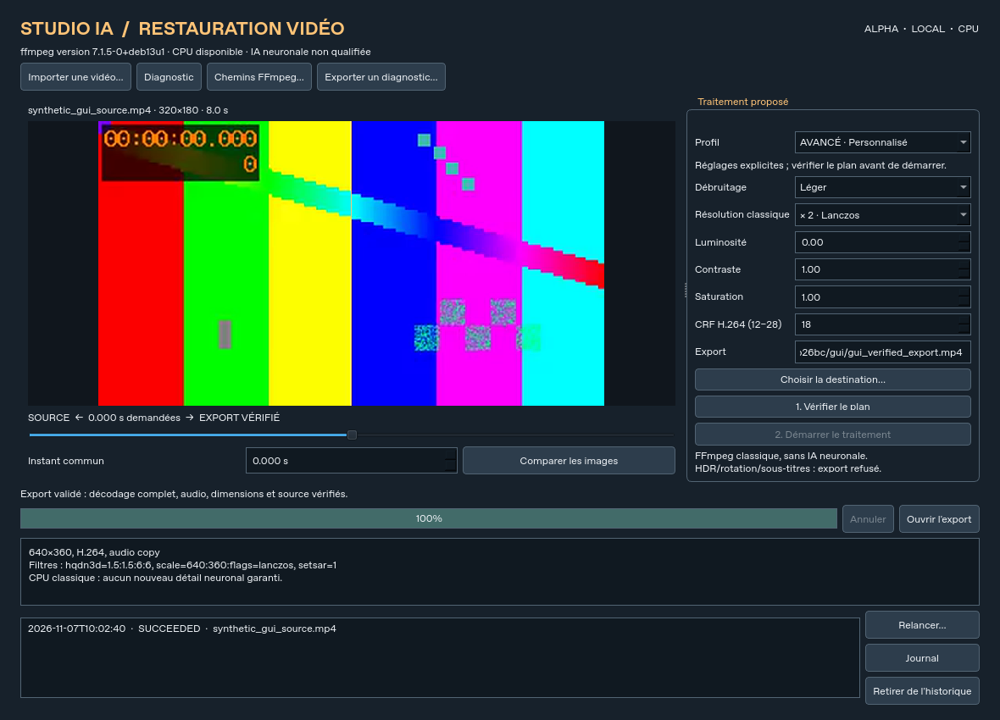

# STUDIO-IA

Application de bureau locale de restauration vidéo — **0.3.0a1, ALPHA expérimentale**.
Import → analyse → plan → traitement CPU réel → vérification complète → comparaison
→ export. Interface Qt française, sans compte, crédits, serveur ou télémétrie.



Travail sur `codex/studio-ia-m003-first-verifiable-build`, aucune fusion dans `main`.
Les tests locaux sont réels. La publication GitHub/CI reste conditionnée aux droits
d'écriture de la connexion ; voir le [rapport de livraison](reports/003/04-delivery.md)
pour les SHA, résultats, artefacts et limitations effectivement vérifiés.

| Fonction | Qualification |
|---|---|
| ffprobe, métadonnées, audio, avertissements | testés sur fixtures synthétiques |
| H.264, débruitage léger/modéré, Lanczos, couleurs légères | FFmpeg CPU réellement exécuté |
| MP4/MKV, audio copié/AAC, vidéos muettes/verticales/VFR | tests de propriétés et décodage intégral |
| UI Qt, progression, annulation, historique, comparaison | clics QTest, captures offscreen et X11 virtuel |
| Protection source/destination, contrôle final | hash original, absence d'écrasement, tests d'échecs |
| Distribution Linux / Windows | consulter le rapport, aucune plateforme présumée validée |
| Video2X, super-résolution/interpolation neuronale | découverte/contrat/registre préparés, exécution non qualifiée |

Un upscale classique n'est pas de l'IA et ne recrée pas des détails fiables.
HDR/BT.2020, >8 bits, rotation, entrelacement, SAR non carré et flux secondaires
sont refusés explicitement dans cette version. Aucun outil de création vidéo.

Installation source (Python 3.12 et FFmpeg/ffprobe avec libx264/AAC) :

```sh
python -m venv .venv
# Linux : source .venv/bin/activate
# Windows PowerShell : .venv\Scripts\Activate.ps1
python -m pip install pip==26.3
python -m pip install -e ".[gui,dev]"
studio-ia doctor
studio-ia-gui
```

Dans l'interface, importer une vidéo, choisir Préservation, sélectionner un nouveau
nom d'export, vérifier le plan puis démarrer. Après validation, comparer les images
au même instant, ouvrir la sortie ou le journal. Double-clic/Entrée sur une tâche
réussie recharge son résultat ; Relancer repart de l'original vers un nouveau nom.
Retirer une entrée de l'historique ne supprime pas les médias. Un diagnostic
exportable omet chemins et métadonnées libres ; relire les noms avant partage.

CLI :

```sh
studio-ia analyze "source.mp4"
studio-ia process "source.mp4" "nouvelle_sortie.mp4" --denoise light --scale 2 --json resultat.json
# Le JSON indique job_directory, contenant plan.json, result.json et pipeline.log.
studio-ia verify "chemin_du_job/plan.json" "nouvelle_sortie.mp4"
```

Les deux binaires sont trouvés dans le PATH ou configurés via « Chemins FFmpeg… » /
`STUDIO_IA_FFMPEG`, `STUDIO_IA_FFPROBE`. Aucune installation automatique au lancement.
Les tests ne téléchargent aucun média ou modèle. `pytest -q -ra` puis
`python scripts/run_e2e.py --output artifacts/e2e` reproduisent les preuves CPU.
Linux sans affichage : `QT_QPA_PLATFORM=offscreen pytest -q -ra`, ou Xvfb pour X11.

[Installation portable et dépannage](INSTALLER.md) · [Architecture et limites](docs/architecture.md) ·
[Tests](docs/testing.md) · [Packaging](docs/packaging.md) · [Hors ligne](docs/offline.md) ·
[Moteurs](docs/engines.md) · [Licences](THIRD_PARTY_NOTICES.md) ·
[Audit](reports/003/00-audit.md) · [Tâches](reports/003/tasks.md)
